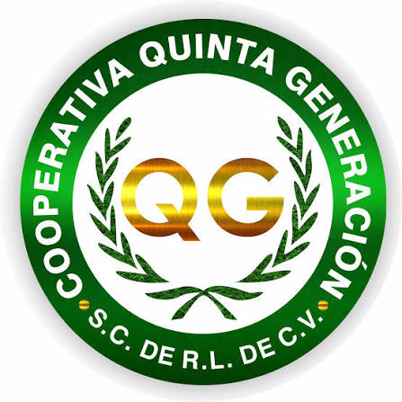
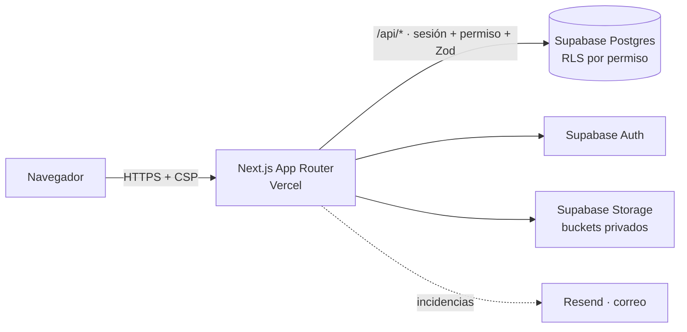

<div align="center">



# SysNomQC

**Sistema de control operativo de la Cooperativa Quinta Generación**

Personal, seguridad e higiene, facturación y combustibles alternos en una sola aplicación web, con permisos por rol y seguridad aplicada en la base de datos.

[](https://nextjs.org)
[](https://react.dev)
[](https://www.typescriptlang.org)
[](https://supabase.com)
[](https://vercel.com)

[Módulos](#módulos) · [Arquitectura](#arquitectura) · [Seguridad](#seguridad) · [Instalación](#instalación) · [Documentación](#documentación)

</div>

---

## Descripción

SysNomQC reemplaza hojas de cálculo y papel por un sistema único para la operación diaria de la cooperativa. Cada cuenta ve y hace solo lo que su rol le permite, y cada movimiento importante queda registrado.

- **Uso interno:** no tiene registro público; un administrador da de alta y autoriza cada cuenta.
- **Varios roles por cuenta:** los permisos se suman, y una cuenta con sede asignada solo opera esa sede.
- **Trazabilidad:** la bitácora de auditoría y los historiales por módulo registran quién hizo qué y cuándo.
- **Reportes:** descarga en PDF y Excel desde cada módulo.

## Módulos

| Módulo | Ruta | Qué resuelve |
| --- | --- | --- |
| 👥 **Empleados** | `/` | Expedientes completos con foto, por área, puesto y asignación. Filtros de activos, bajas y seguimiento, y expediente imprimible. |
| 🦺 **EPP** (seguridad e higiene) | `/epp` | Inventario de equipo de protección por sede, entregas a cada trabajador, stock mínimo y solicitudes de compra. |
| 🧾 **Facturas** | `/facturas` | Flujo completo e inmodificable: enviada → firmada → cargada al sistema → contrarecibo → complemento de pago. El folio es automático, los datos se leen del PDF, se lleva el cierre semanal y el historial. |
| 🔥 **SCA · Combustibles alternos** | `/sca` | Báscula, agenda, proveedores y semáforo SEMARNAT de sustitución térmica, con bloqueo al 30 %. |
| 🔔 **Notificaciones** | `/notificaciones` | Avisos calculados con los datos reales: stock bajo, expedientes incompletos, permisos por vencer. |
| 🛡️ **Usuarios y roles** | `/admin` | Alta de cuentas, roles, permisos y sedes. |

## Arquitectura



```
src/
├── app/            # Rutas (App Router) y API (/api/*)
│   ├── (app)/      # Sistema principal: empleados, EPP, facturas, admin…
│   └── sca/        # Sistema de combustibles alternos (presentación propia)
├── features/       # Un módulo por carpeta: componentes y lógica de pantalla
├── lib/            # Reglas de negocio, permisos, Supabase, validaciones
└── shared/         # Layout, navegación, UI y reportes compartidos
supabase/
└── migrations/     # Esquema, RLS, funciones y triggers (se aplican en orden)
docs/wiki/          # Documentación detallada por módulo
```

**Stack:**
- Next.js 16 y React 19 con TypeScript.
- Supabase: Postgres, Auth y Storage.
- Zod para validar entradas.
- jsPDF y ExcelJS para los reportes.
- unpdf para leer y mostrar los PDF.
- lucide-react para los íconos.

## Seguridad

El sistema maneja datos personales, así que la seguridad no depende solo de la interfaz:

- 🔐 **Permisos en la base:** RLS en todas las tablas, con `has_app_permission`. Saltarse la API llamando directo a Supabase no da acceso.
- 🚫 **Sin acceso anónimo:** el rol `anon` no tiene permisos en tablas, vistas ni funciones.
- 🧱 **Inicio de sesión protegido:** todo pasa por el servidor. Se valida el origen, hay límite por IP y un bloqueo temporal tras varios intentos fallidos, reforzado con un hook de Supabase Auth.
- 📜 **Reglas de negocio en la base:** triggers que impiden modificar facturas, cerrar tickets dos veces o pasar del límite de sustitución.
- 🧾 **Auditoría:** se registran los cambios y las consultas de expedientes, sin guardar datos personales en la bitácora.
- 🌐 **Cabeceras estrictas:**
  - CSP, HSTS (2 años), `X-Frame-Options: DENY`, `Permissions-Policy` y COOP/CORP.
  - Los buscadores solo indexan la pantalla de inicio de sesión.
- 🗂️ **Archivos privados:** buckets sin acceso público, enlaces firmados temporales y fotos sin datos EXIF.
- ⏱️ **Sesión:** se cierra tras 30 minutos sin uso y las contraseñas piden mínimo 12 caracteres.

Detalle completo y configuración pendiente en paneles: [docs/wiki/Seguridad.md](docs/wiki/Seguridad.md).

## Instalación

### Requisitos

- Node.js **20.9** o posterior
- Un proyecto de **Supabase**, local (`supabase start`) o en la nube

### Pasos

```bash
git clone https://github.com/carloss-r/SysNomQC.git
cd SysNomQC
npm install
cp .env.example .env.local   # y completa los valores
npm run dev                  # http://localhost:3000
```

### Base de datos

1. Aplica las migraciones de [`supabase/migrations/`](supabase/migrations) **en orden de nombre**. Usa `supabase db reset` en local, o el SQL Editor o `supabase db push` en la nube.
2. Crea las cuentas en **Authentication → Users**. No hay registro público.
3. Autoriza la primera cuenta como Super administrador. Las siguientes se administran desde `/admin`:

   ```sql
   insert into public.authorized_users (user_id, email, role_id)
   values ('UUID-DE-LA-CUENTA', 'admin@tu-dominio.com',
           (select id_rol from public.roles where es_sistema limit 1));
   ```

### Variables de entorno

| Variable | Ámbito | Uso |
| --- | --- | --- |
| `NEXT_PUBLIC_SUPABASE_URL` | Público | URL del proyecto de Supabase |
| `NEXT_PUBLIC_SUPABASE_PUBLISHABLE_KEY` | Público | Llave publicable (anon) |
| `SUPABASE_SERVICE_ROLE_KEY` | **Solo servidor** | Administración de cuentas, bitácora y control de inicio de sesión |
| `NEXT_PUBLIC_SITE_URL` | Público | Dominio de producción (sitemap y robots) |
| `RESEND_API_KEY` | Solo servidor | Correos de incidencias y avisos |
| `INCIDENT_EMAIL_TO` / `INCIDENT_EMAIL_FROM` | Solo servidor | Destinatario y remitente de incidencias |
| `ECOLOGY_EMAIL_TO` | Solo servidor | Destinatarios del aviso del semáforo SEMARNAT |

> [!WARNING]
> Nunca pongas `SUPABASE_SERVICE_ROLE_KEY` con el prefijo `NEXT_PUBLIC_`, y nunca subas `.env.local` al repositorio.

### Scripts

| Comando | Descripción |
| --- | --- |
| `npm run dev` | Servidor de desarrollo |
| `npm run build` | Compilación de producción |
| `npm run start` | Sirve la compilación |
| `npm run lint` | ESLint sobre `src/` |

## Despliegue

Se despliega en **Vercel**:

| Rama | Entorno |
| --- | --- |
| `development` | Preview |
| `main` | Production |

1. Configura las variables de entorno en Vercel para cada entorno.
2. Aplica las migraciones nuevas en el Supabase que corresponda.
3. Despliega. Los cambios de variables solo aplican a despliegues nuevos.

## Documentación

La documentación detallada vive en [`docs/wiki/`](docs/wiki/Home.md):

| Primeros pasos | Módulos | Referencia |
| --- | --- | --- |
| [Instalación y entornos](docs/wiki/Instalacion-y-entornos.md) | [Empleados](docs/wiki/Modulo-Empleados.md) | [Base de datos](docs/wiki/Base-de-datos.md) |
| [Arquitectura](docs/wiki/Arquitectura.md) | [EPP](docs/wiki/Modulo-EPP.md) | [API](docs/wiki/API.md) |
| [Guía de desarrollo](docs/wiki/Guia-de-desarrollo.md) | [Facturas](docs/wiki/Modulo-Facturas.md) | [Roles y permisos](docs/wiki/Roles-y-permisos.md) |
| | [Combustibles alternos](docs/wiki/Modulo-Combustibles-Alternos.md) | [Seguridad](docs/wiki/Seguridad.md) |
| | [Notificaciones e incidencias](docs/wiki/Notificaciones-e-incidencias.md) | |

## Licencia

Software privado de la **Cooperativa Quinta Generación, S.C. de R.L. de C.V.** Todos los derechos reservados. No se permite su uso, copia ni distribución sin autorización.
